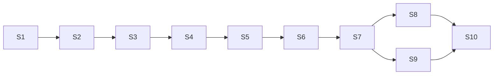

# TRD：macos-hello

| 项 | 内容 |
|----|------|
| 版本 | v1.0 |
| 上游文档 | `docs/PRD.md`（v1 范围） |
| 目标读者 | 实现者、测试者、CI 维护者 |
| 设计范围 | 默认问候命令、`--name` 参数、自动化测试、GitHub Actions CI、零运行时依赖 |
| 明确不做 | 图形界面、网络请求、Xcode 或原生二进制、npm 公共发布 |

现状基线：仓库中已提交 `package.json`、`pnpm-lock.yaml`、`.gitignore`、`README.md`；`bin/hello.js`、`src/`、`test/`、`.github/` 尚不存在。本 TRD 的故事按此基线拆分。

## 1. 架构总览

### 1.1 系统定位与边界

macos-hello 是一个单进程、无状态的命令行程序。它唯一的外部契约是进程边界：命令行参数、标准输出、标准错误、退出码。系统内不存在数据库、网络调用、配置文件读写、环境变量读取、时钟或随机数依赖。

部署形态是仓库内脚本：通过 `node bin/hello.js` 直接执行，同时也通过 `package.json` 的 `bin` 字段声明为可执行入口 `hello`；不发布到 npm。

参与者与外部系统：

- macOS 开发者：本地执行命令，按精确输出自检环境。
- CI 验证人员：通过 GitHub Actions 在 Node.js 20.x 上运行同一套测试。
- GitHub 私有仓库：托管代码、Actions 流水线与合并门禁。

### 1.2 组件与职责

| 组件 | 路径 | 职责 | 边界规则 |
|------|------|------|----------|
| CLI 适配层 | `bin/hello.js` | 读取 `argv`、调用参数解析、写 stdout/stderr、设置退出码 | 唯一允许触碰 `process` 的文件；不承载问候格式化规则 |
| 核心逻辑 | `src/greet.js` | 参数解析（纯函数）、问候格式化（纯函数）、`UsageError` 类型 | 不做 I/O、不读环境变量、不使用时间或随机数 |
| 单元测试 | `test/greet.test.js` | 直接导入核心函数做单测 | 只验证纯函数的输入输出 |
| 黑盒测试 | `test/cli.test.js` | `spawnSync` 启动 CLI，断言 stdout、stderr、退出码 | 只通过进程边界断言，不导入内部实现 |
| 交付流水线 | `.github/workflows/ci.yml` | Node.js 20.x 环境安装、零依赖断言、运行 `pnpm test` | 权限最小化，仅 `contents: read` |
| 仓库基线 | `package.json`、`pnpm-lock.yaml`、`.gitignore`、`.nvmrc`、`README.md` | 依赖清单、锁文件、忽略规则、Node 版本、使用说明 | 运行时依赖与开发依赖均为空 |

依赖方向固定为单向：`test -> bin/src`，`bin -> src`；`src` 不反向依赖任何上层组件。

### 1.3 运行时流程

1. 调用方执行 `node bin/hello.js [--name <value>]`。
2. `bin/hello.js` 取 `process.argv.slice(2)`，交给 `parseCliArgs`。
3. `parseCliArgs` 调用 `node:util.parseArgs`（strict 模式、禁止位置参数）；任何参数错误统一包装为 `UsageError`。
4. 成功时返回 `{ name? }`；`formatGreeting(name)` 生成 `Hello, <name>!`，未提供有效名称时使用 `World`。
5. `process.stdout.write` 写出单行文本加一个换行符，进程正常结束，退出码 0。
6. 捕获 `UsageError` 时，向 stderr 写出 `Usage: hello [--name <name>]` 加换行，设置 `process.exitCode = 1`，stdout 保持为空。
7. 其他异常不被吞掉，交给 Node 以非零码退出；这属于实现缺陷，不在产品契约内。

```mermaid
flowchart LR
  dev[macOS 开发者] -->|node bin/hello.js [--name X]| cli[bin/hello.js 适配层]
  cli --> core[src/greet.js 纯函数核心]
  cli -->|stdout 精确文本 / stderr Usage / 退出码| dev
  ci[GitHub Actions CI] -->|pnpm test| tests[test/ node:test]
  tests -->|spawnSync 黑盒| cli
  tests -->|import 单元| core
  repo[GitHub 私有仓库] --> ci
  ruleset[main ruleset: required check test] --- repo
```

### 1.4 目录结构

```text
macos-hello/
├── bin/hello.js              # 新增：CLI 适配层
├── src/greet.js              # 新增：纯函数核心
├── test/greet.test.js        # 新增：单元测试
├── test/cli.test.js          # 新增：黑盒验收测试
├── .github/workflows/ci.yml  # 新增：GitHub Actions 工作流
├── .nvmrc                    # 新增：本地 Node 20
├── package.json              # 已有：清单与脚本
├── pnpm-lock.yaml            # 已有：锁文件
├── .gitignore                # 已有
└── README.md                 # 已有：补充支持范围与用法
```

### 1.5 架构约束

- 输出模板只允许存在一处（`formatGreeting`），解析层与测试不得复制字符串。
- `src/` 内所有函数必须是纯函数；副作用只允许出现在 `bin/hello.js`。
- 成功路径的 stdout 只允许包含产品输出本身，不得混入任何日志、警告、时间戳。
- 不引入构建步骤；仓库中的源码即运行时产物。
- 退出码通过 `process.exitCode` 设置，不使用 `process.exit` 提前终止，避免管道输出被截断。
- 运行时零第三方依赖，开发期零第三方依赖；CI 对此做显式断言。

### 1.6 质量属性

| 属性 | 目标 | 设计手段 |
|------|------|----------|
| 确定性 | 相同参数永远得到相同字节输出 | 纯函数模板、无时钟/随机/环境依赖、精确字符串断言 |
| 可测试性 | 纯逻辑与进程行为均可独立验证 | `bin`/`src` 分离，单元测试 + `spawnSync` 黑盒测试 |
| 零依赖 | 运行时与开发期依赖条目数均为 0 | 只用 Node 内置模块；CI 断言依赖清单为空 |
| 可移植性 | macOS 与 Ubuntu 行为一致 | 不使用平台相关 API、路径使用 `URL`/`path` 抽象 |
| 可维护性 | 约 60 行实现、单一输出模板 | 最少文件、最小 API 面、无构建工具 |
| 可观测性 | 结果可判定、失败可定位 | 精确 stdout/stderr/退出码契约 + node:test TAP 输出 + CI 状态检查 |

## 2. 技术选型与理由

### 2.1 选型总表

| 领域 | 决策 | 备选 | 理由 | 代价与取舍 |
|------|------|------|------|------------|
| 运行时 | Node.js 20.x（`engines.node >= 20`，`.nvmrc` 为 `20`，CI 固定 20.x） | Node 22/24、Deno、Bun | PRD 约束为 Node.js 20+；Node 20 原生支持 ESM、`util.parseArgs`、`node:test`，无需任何工具链 | Node 20 已于 2026-04 结束维护，形成升级债（TR-01）；本地验收必须切到 20.x |
| 语言 | JavaScript + ESM（`"type": "module"`） | TypeScript、CommonJS | 零构建、零 devDependency；ESM 是 Node 20 的主流模块形态；CommonJS 无额外收益 | 无静态类型；当前约 60 行，可用 JSDoc 补充类型说明 |
| 包管理器 | pnpm 10.28.2，通过 `packageManager` 钉住，锁文件 v9.0 已入库 | npm、yarn | PRD 验收命令为 `pnpm test`；仓库已有 pnpm 锁文件；pnpm 安装快、依赖隔离严格 | 本地需安装 pnpm 10；Node 25 已不再内置 corepack，README 需写明安装方式 |
| 参数解析 | `node:util.parseArgs` | 手写解析、commander、yargs | Node 内置零依赖；strict 模式对未知选项、缺失取值、位置参数直接抛错，正好映射 PRD Q2/Q5；原生支持 `--name=value` | 内置错误文案为英文且不直接展示给用户，需包装成统一 Usage；不支持短选项与自动 help（Q3 明确不需要） |
| 测试框架 | `node:test` + `node:assert/strict` | Vitest、Jest | 零 devDependency；Node 20 原生；TAP 输出包含失败用例名称，满足 US-04 对日志定位的要求 | 断言 API 朴素、无快照能力；本项目 15 条左右用例足够 |
| 测试命令 | `node --test`（`package.json` 已配置 `"test": "node --test"`） | 逐个列出测试文件 | 自动发现 `*.test.js`；本地与 CI 使用完全相同的命令，保证结果一致 | 测试文件必须遵循 `*.test.js` 命名 |
| CI 运行器 | GitHub Actions，`ubuntu-latest`，Node.js 20.x | macOS runner、多版本矩阵、自托管 | 纯 JS 无原生依赖，平台行为一致；ubuntu 分钟消耗约为 macOS 的十分之一，启动更快 | 未自动覆盖 macOS runner；若未来引入原生扩展需补 macOS job |
| CI 中安装 pnpm | `pnpm/action-setup@v4` 显式安装 10.28.2，`setup-node` 启用 pnpm 缓存 | corepack、npm ci | 不依赖 Node 内置 corepack（Node 25 已移除）；版本显式、结果可复现 | workflow 与 `package.json` 两处版本号需同步升级 |
| 输出方式 | `process.stdout.write` + `process.exitCode` | `console.log` + `process.exit` | `write` 可字节级控制换行；`exitCode` 等待 stdout 刷完，避免管道场景输出被截断 | 换行需手写；失去 `console.log` 的便利 |
| 依赖策略 | 运行时依赖 0，开发依赖 0 | 引入测试框架、参数库 | 直接满足 PRD 目标 4 与 US-05；锁文件仅保留空 importers | 无第三方能力可用；当前规模不需要 |
| 合并门禁 | GitHub Repository ruleset：main 需 PR，必需状态检查 `test`，不要求人工批准 | 人工约定、required review | 单人维护无法自审；用 CI 做客观门禁，对应 PRD 风险缓解措施 | 治理强度有限；依赖仓库管理员权限（TR-03） |
| 目录结构 | `bin/` 适配层 + `src/` 纯核心 + `test/` 双层测试 | 单文件脚本 | 纯函数可单测，进程契约可黑盒测，副作用集中在入口 | 比单文件多两个模块；收益是可验证性，成本可忽略 |

### 2.2 被否决方案的明确理由

- TypeScript：需要 `tsc` 作为开发依赖并引入构建步骤，与“零依赖、无构建”的目标冲突；约 60 行代码用 JSDoc 足够表达契约。
- Vitest/Jest：为 15 条用例引入完整测试框架及传递依赖，增加安装成本与供应链风险；`node:test` 已覆盖需求。
- commander/yargs：会引入运行时依赖，直接违反 PRD 目标 4 与 US-05；本项目的参数面只有 `--name`，内置解析器足够。
- 手写参数解析：需要自行处理 `--name=value`、未知选项、位置参数、缺失取值等边界，重复实现 `parseArgs` 已有能力，且更容易出现行为不一致。
- macOS CI runner：成本高、启动慢，且程序不使用任何 macOS 专属 API；平台差异风险由本地验收覆盖。
- `process.exit()`：会提前终止事件循环，管道输出存在截断风险；统一使用 `process.exitCode`。
- `console.log()`：额外隐式换行与格式化语义，不利于字节级精确断言；改用 `process.stdout.write`。

## 3. 数据模型与接口

### 3.1 数据模型

系统无持久化数据、无数据库、无迁移、无配置文件。唯一的数据结构是单次进程内的值对象与错误类型：

```ts
// In-memory contract only, no runtime artifact
type CliArgs = { name?: string };   // undefined means --name not provided
class UsageError extends Error { name: 'UsageError' }
const DEFAULT_NAME = 'World';
const USAGE = 'Usage: hello [--name <name>]';
```

不存在状态机、并发访问、缓存失效问题；单次执行的生命周期即为一次“事务”。

### 3.2 参数语法与解析决策

```text
invocation := "node bin/hello.js" args
args       := ε
            | "--name" value
            | "--name=" value
value      := 任意非空字符串（由 shell 解析，空格原样传递）
```

解析决策：

| 决策 | 内容 | 依据 |
|------|------|------|
| D1 换行 | 成功路径 stdout 恰为一行文本，末尾恰好一个 `\n` | PRD Q1 |
| D2 空值 | `--name ""`（零长度）视为非法用法，stderr 输出 Usage，退出码 1 | PRD Q4 |
| D3 未知参数 | 未知长选项、未知短选项、位置参数均视为非法用法，退出码 1 | PRD Q5 |
| D4 帮助 | 不提供 `--help` 行为；`--help`、`-h` 按未知选项处理，退出码 1 | PRD Q3 |
| D5 重复参数 | 多次传入 `--name` 时以最后一次为准（`util.parseArgs` 默认语义） | 补充决策，固化歧义 |
| D6 内联形式 | `--name=Alice` 与 `--name Alice` 等价；`--name=-x` 可传入以横线开头的值 | 补充决策，`parseArgs` 原生支持 |
| D7 横线取值 | 独立参数形式的取值以选项前缀开头（如 `--name --foo`、`--name -x`）会产生歧义错误，按非法用法处理，退出码 1 | 补充决策，安全失败 |
| D8 原样输出 | 名称原样拼接，不去空格、不转义、不限制长度；仅由空格组成的非空值同样原样输出 | PRD Q8 |
| D9 固定英文 | 模板固定为 `Hello, <name>!`，不做本地化 | PRD Q6 |
| D10 程序名 | Usage 文案固定使用 `hello`，不取 `process.argv[1]`，保证不同调用路径下输出一致 | 补充决策 |

### 3.3 CLI 输入输出契约

| 场景 | 命令示例 | stdout | stderr | 退出码 |
|------|----------|--------|--------|--------|
| 默认问候 | `node bin/hello.js` | `Hello, World!` + `\n` | 空 | 0 |
| 自定义名称 | `node bin/hello.js --name Alice` | `Hello, Alice!` + `\n` | 空 | 0 |
| 含空格名称 | `node bin/hello.js --name "Wu Ming"` | `Hello, Wu Ming!` + `\n` | 空 | 0 |
| 内联形式 | `node bin/hello.js --name=Alice` | `Hello, Alice!` + `\n` | 空 | 0 |
| 缺少取值 | `node bin/hello.js --name` | 空 | `Usage: hello [--name <name>]` + `\n` | 1 |
| 空字符串取值 | `node bin/hello.js --name ""` | 空 | 同上 | 1 |
| 未知选项 | `node bin/hello.js --foo`、`--help`、`-h` | 空 | 同上 | 1 |
| 位置参数 | `node bin/hello.js extra` | 空 | 同上 | 1 |
| 歧义取值 | `node bin/hello.js --name -x` | 空 | 同上 | 1 |

退出码定义：

| 退出码 | 含义 | 是否产品契约 |
|--------|------|--------------|
| 0 | 成功输出问候 | 是 |
| 1 | 参数或用法错误 | 是 |
| 其他非零 | 未捕获的实现缺陷，由 Node 默认处理 | 否，不纳入验收 |

### 3.4 模块接口

```js
// src/greet.js
export const DEFAULT_NAME = 'World';
export const USAGE = 'Usage: hello [--name <name>]';

export class UsageError extends Error {
  constructor(message = USAGE) {
    super(message);
    this.name = 'UsageError';
  }
}

// Pure: returns `Hello, ${name}!`; name defaults to DEFAULT_NAME.
export function formatGreeting(name = DEFAULT_NAME) {}

// Pure: maps every parseArgs failure and an empty name to UsageError.
export function parseCliArgs(argv) {}
```

契约细节：

- `formatGreeting` 不校验空字符串；空值拦截发生在 `parseCliArgs`，调用方保证传入非空字符串或 `undefined`。
- `parseCliArgs` 不读取 `process`，接收纯字符串数组；返回 `{ name }` 或空对象，失败抛 `UsageError`。
- 所有 `ERR_PARSE_ARGS_*` 错误在 `parseCliArgs` 内被捕获并转换为 `UsageError`，不向调用方泄露 Node 内置英文错误文案。

入口主流程：

```js
#!/usr/bin/env node
import { formatGreeting, parseCliArgs, UsageError, USAGE } from '../src/greet.js';

try {
  const { name } = parseCliArgs(process.argv.slice(2));
  process.stdout.write(`${formatGreeting(name)}\n`);
} catch (error) {
  if (error instanceof UsageError) {
    process.stderr.write(`${USAGE}\n`);
    process.exitCode = 1;
  } else {
    throw error;
  }
}
```

### 3.5 包清单与脚本契约

```json
{
  "name": "macos-hello",
  "private": true,
  "type": "module",
  "bin": { "hello": "./bin/hello.js" },
  "engines": { "node": ">=20" },
  "packageManager": "pnpm@10.28.2",
  "scripts": {
    "test": "node --test",
    "lint": "node --check bin/hello.js",
    "build": "node --check bin/hello.js"
  }
}
```

- `dependencies`、`devDependencies`、`optionalDependencies`、`peerDependencies` 均不声明。
- `private: true` 阻止误发布；`bin` 声明仅用于本地链接，不是发布产物。
- 保留现有 `lint`/`build` 脚本（`node --check`）作为语法预检，不新增工具。
- `.nvmrc` 内容为 `20`，让本地验收与 CI 对齐。
- `pnpm-lock.yaml` 必须提交，CI 使用 `--frozen-lockfile`。

### 3.6 CI 工作流契约

```yaml
name: CI

on: [push, pull_request]

permissions:
  contents: read

concurrency:
  group: ci-${{ github.ref }}
  cancel-in-progress: true

jobs:
  test:
    name: test
    runs-on: ubuntu-latest
    timeout-minutes: 10
    steps:
      - uses: actions/checkout@v4
      - uses: pnpm/action-setup@v4
        with:
          version: 10.28.2
          run_install: false
      - uses: actions/setup-node@v4
        with:
          node-version: 20.x
          cache: pnpm
      - run: pnpm install --frozen-lockfile
      - name: Assert zero runtime dependencies
        run: |
          node -e "const p=require('./package.json');const d={...(p.dependencies||{}),...(p.optionalDependencies||{}),...(p.peerDependencies||{})};const n=Object.keys(d).length;console.log('runtime dependencies:',n);if(n){console.error(d);process.exit(1)}"
      - run: pnpm test
```

- job 名称固定为 `test`，它就是后续必需状态检查的上下文名称。
- 触发条件覆盖任意分支推送与拉取请求，满足 US-04 第一条验收标准。
- 不配置路径过滤：被跳过的必需检查可能长期处于 pending，导致 PR 无法合并。
- 单 job、单一 Node 版本、ubuntu 运行器，控制私有仓库的 Actions 分钟消耗。

### 3.7 合并门禁契约

在 GitHub 仓库上为 `main` 配置 Repository ruleset：

- 合并必须通过拉取请求（禁止直接推送）。
- 必需状态检查：`test`。
- 不要求人工批准：单人维护无法批准自己的 PR。
- 禁止强制推送与分支删除。

验证命令：

```bash
gh api repos/{owner}/{repo}/rulesets --jq '.[].name'
gh api repos/{owner}/{repo}/rulesets/{id}
```

若仓库计划或组织策略不支持 ruleset，S8 视为未达成并作为阻塞项上报，不以人工约定替代该验收标准。

### 3.8 错误分类

| 类别 | 触发条件 | 输出位置与内容 | 退出码 | 覆盖用例 |
|------|----------|----------------|--------|----------|
| 用法错误 | 缺失取值、空字符串、未知选项、位置参数、歧义取值 | stderr：`Usage: hello [--name <name>]` + `\n`；stdout 为空 | 1 | E2E-05/06/08/09/10 |
| 实现缺陷 | 其他未预期异常 | Node 默认堆栈输出 | 非零（不承诺） | 不纳入验收 |

## 4. 里程碑与故事拆分

### 4.1 故事总表

| Story | 标题 | 对应 US | 里程碑 | 预估（人日） |
|-------|------|---------|--------|--------------|
| S1 | 校验零依赖项目骨架 | US-05 | M1 | 0.25 |
| S2 | 实现默认问候入口 | US-01 | M1 | 0.25 |
| S3 | 实现 --name 正常取值问候 | US-02 | M2 | 0.25 |
| S4 | 非法用法返回 Usage 提示并以退出码 1 结束 | US-02 | M2 | 0.25 |
| S5 | 编写核心函数单元测试 | US-03 | M3 | 0.25 |
| S6 | 编写 CLI 黑盒验收测试 | US-03 | M3 | 0.25 |
| S7 | 建立 GitHub Actions 测试工作流 | US-04 | M4 | 0.25 |
| S8 | 配置主分支合并前状态检查 | US-04 | M4 | 0.25 |
| S9 | 演练测试拦截回归 | US-03、US-04 | M5 | 0.25 |
| S10 | 端到端验收复跑 | US-01~US-05 | M5 | 0.25 |

合计 2.5 人日，与 PRD 第 6 节里程碑预算一致；单条故事均不超过 1 人日。

### 4.2 故事明细

**S1 校验零依赖项目骨架（US-05）**

- 交付物：核对并补齐 `package.json`（`private`、`type: module`、`bin`、`engines`、`packageManager`、`test` 脚本）、`.nvmrc`、`README.md` 的支持范围与前置条件说明；确认锁文件、`.gitignore` 已提交。
- 完成定义：依赖四类字段均为空；`pnpm list --prod --depth 0` 无条目；README 写明支持 macOS + Node 20.x、pnpm 10.28.2 安装方式、三条使用命令。
- 证据：`package.json` 内容、`pnpm list --prod` 输出、README 片段。

**S2 实现默认问候入口（US-01）**

- 交付物：`bin/hello.js`（含 shebang）、`src/greet.js` 的 `formatGreeting` 与常量；无参数路径。
- 完成定义：`node bin/hello.js` 输出恰为 `Hello, World!\n`，stderr 为空，退出码 0；连续两次执行输出逐字节一致；`node --check bin/hello.js` 通过。
- 证据：命令输出与 `od -c` 或等价字节检查、两次执行比对。

**S3 实现 --name 正常取值问候（US-02）**

- 交付物：`parseCliArgs` 使用 `node:util.parseArgs`，支持 `--name Alice`、`--name "Wu Ming"`、`--name=Alice`；未提供时回退默认值。
- 完成定义：E2E-03、E2E-04、E2E-07、E2E-11、E2E-12 通过；`Hello, Alice!`、`Hello, Wu Ming!` 精确输出；退出码均为 0。
- 证据：命令输出；单元测试将在 M3 补齐。

**S4 非法用法返回 Usage 提示并以退出码 1 结束（US-02）**

- 交付物：`UsageError`、解析错误包装、空值拦截、stderr 用法提示、退出码设置。
- 完成定义：E2E-05、E2E-06、E2E-08、E2E-09、E2E-10 通过：stdout 为空，stderr 恰为 `Usage: hello [--name <name>]\n`，退出码 1；`--help`、`-h` 同样按非法用法处理。
- 证据：各命令的 stdout、stderr、退出码记录。

**S5 编写核心函数单元测试（US-03）**

- 交付物：`test/greet.test.js`，基于 `node:test` 与 `node:assert/strict`，覆盖 UT-01~UT-14。
- 完成定义：`pnpm test` 执行成功、失败数 0；单元用例覆盖默认格式化、自定义格式化、含空格名称、合法解析、空值、缺失取值、未知选项、位置参数、歧义取值、重复参数。
- 证据：`pnpm test` TAP 输出。

**S6 编写 CLI 黑盒验收测试（US-03）**

- 交付物：`test/cli.test.js` 及 `runCli` 辅助函数（`spawnSync(process.execPath, [CLI_PATH, ...args])`），覆盖 E2E-01~E2E-12。
- 完成定义：三类必需场景（默认输出、`--name` 正常值、`--name` 缺失取值）各有至少 1 条用例并通过；输出使用整串 `strictEqual` 断言，包含换行；断言 stdout、stderr、退出码三件套。
- 证据：`pnpm test` 输出；用例与 PRD 验收标准追溯矩阵（见 6.3）。

**S7 建立 GitHub Actions 测试工作流（US-04）**

- 交付物：`.github/workflows/ci.yml`，按 3.6 节契约实现；含零运行时依赖断言步骤。
- 完成定义：向远端分支推送后工作流自动触发；`test` job 在 Node.js 20.x 上全绿；日志可见每条测试名与 `runtime dependencies: 0`；单次运行耗时低于 2 分钟。
- 证据：Actions 运行链接、`gh run list` 输出、job 日志片段。

**S8 配置主分支合并前状态检查（US-04）**

- 交付物：`main` 分支 Repository ruleset（需 PR、必需检查 `test`、禁止强推、禁止删除分支）。
- 完成定义：构造一个测试 PR，其 CI 失败时合并按钮不可用或 API 返回拒绝；CI 通过后 PR 可合并；ruleset 可通过 API 读取。
- 证据：ruleset JSON、失败 PR 的检查状态截图或 `gh pr view --json statusCheckRollup` 输出。

**S9 演练测试拦截回归（US-03、US-04）**

- 交付物：一次受控的变异演练记录：在临时分支把模板改为缺少感叹号（或修改默认输出），本地运行 `pnpm test` 应失败且为非零退出码，推送后 CI 失败且日志中出现失败用例名称；随后还原并确认恢复绿色。
- 完成定义：本地与 CI 两侧均能定位到失败用例；主分支最终保持绿色；演练不留在主干。
- 证据：本地失败输出、CI 失败日志中的 `not ok` 行、还原后的绿色运行记录。

**S10 端到端验收复跑（US-01~US-05）**

- 交付物：在临时目录重新克隆仓库，使用 Node.js 20.x 执行 `pnpm install --frozen-lockfile`，依次运行 PRD 第 3 节四条场景命令与 `pnpm test`，核对第 5 节全部成功指标并填入验收记录（PR 描述或验收报告）。
- 完成定义：五项成功指标全部达标；本地结果与 CI 日志一致；任一指标不达标即判定该阶段未完成并回到对应故事。
- 证据：命令输出、CI 运行链接、指标核对表。

### 4.3 里程碑视图

| 里程碑 | 故事 | 人日 | 完成标准 |
|--------|------|------|----------|
| M1 命令可用 | S1、S2 | 0.5 | US-01 全部验收标准通过 |
| M2 参数支持 | S3、S4 | 0.5 | US-02 全部验收标准通过 |
| M3 测试就绪 | S5、S6 | 0.5 | US-03 前两条验收标准通过 |
| M4 CI 就绪 | S7、S8 | 0.5 | US-04 全部验收标准通过 |
| M5 交付验收 | S9、S10 | 0.5 | US-03 第三条与第 5 节全部指标达标 |

每个里程碑完成即推送并触发 CI；CI 失败时先修复再进入下一里程碑，保持可回退、可追溯。

### 4.4 覆盖核对

| PRD 编号 | 覆盖故事 |
|----------|----------|
| 目标 1：默认输出 `Hello, World!` | S2、S6、S10 |
| 目标 2：`--name` 自定义 | S3、S4、S6、S10 |
| 目标 3：自动化测试与 CI | S5、S6、S7、S8、S9、S10 |
| 目标 4：零运行时依赖 | S1、S7、S10 |
| US-01 默认问候输出 | S2、S6、S10 |
| US-02 自定义问候对象 | S3、S4、S6、S10 |
| US-03 自动化测试覆盖 | S5、S6、S9、S10 |
| US-04 持续集成 | S7、S8、S9、S10 |
| US-05 零运行时依赖 | S1、S7、S10 |

## 5. 依赖关系

| Story | 依赖 | 说明 |
|-------|------|------|
| S1 | 无 | 仓库基线已存在，先核对清单与文档，无前置开发项 |
| S2 | S1 | 入口依赖包清单中的 `bin`、`type: module` 与 Node 版本约定 |
| S3 | S2 | 参数解析在既有入口模块上扩展，共享同一输出模板 |
| S4 | S3 | 错误分支建立在解析器之上，依赖已冻结的参数语义 |
| S5 | S4 | 单元测试针对已完成的函数签名与行为编写 |
| S6 | S5 | 复用测试辅助函数，在完整行为矩阵上做黑盒断言 |
| S7 | S6 | CI 需要一个本地可全绿执行的测试命令与用例集 |
| S8 | S7 | 必需状态检查的名称来自已存在且已运行的 `test` job |
| S9 | S7 | 回归演练需在本地测试与 CI 两侧观察失败，CI 必须先就绪 |
| S10 | S8、S9 | 最终验收依赖合并门禁与回归演练均已完成 |



按 S1、S2、S3、S4、S5、S6、S7、S8、S9、S10 的顺序执行即可满足全部依赖，依赖图无环。S8 与 S9 在 S7 之后可交换顺序，不构成循环。

## 6. 测试策略

### 6.1 分层与工具

| 层级 | 工具 | 范围 | 数量 | 特点 |
|------|------|------|------|------|
| 单元测试 | `node:test` + `node:assert/strict` | `formatGreeting`、`parseCliArgs` | 14 条 | 快速、无进程创建，锁定纯函数契约 |
| 黑盒验收测试 | `node:test` + `node:child_process.spawnSync` | 真实 CLI 进程的 stdout/stderr/退出码 | 12 条 | 与 PRD 验收口径完全一致，优先于内部实现断言 |
| CI 验证 | GitHub Actions | 推送与 PR 的完整测试运行 | 3 条检查 | 覆盖 US-04 三条验收标准 |
| 验收步骤 | 手工命令 | 干净环境复跑、依赖清单核对 | 1 组 | 覆盖 US-05 与第 5 节指标 |

测试金字塔在此项目中是“倒置”的：黑盒用例占主导，因为 PRD 的验收标准全部以进程输出描述；单元测试作为快速定位手段存在。

### 6.2 用例清单

单元用例：

| ID | 对象 | 输入 | 期望 |
|----|------|------|------|
| UT-01 | `formatGreeting` | 无参数 | `Hello, World!` |
| UT-02 | `formatGreeting` | `Alice` | `Hello, Alice!` |
| UT-03 | `formatGreeting` | `Wu Ming` | `Hello, Wu Ming!` |
| UT-04 | `parseCliArgs` | `[]` | `{}` |
| UT-05 | `parseCliArgs` | `['--name', 'Alice']` | `{ name: 'Alice' }` |
| UT-06 | `parseCliArgs` | `['--name=Alice']` | `{ name: 'Alice' }` |
| UT-07 | `parseCliArgs` | `['--name', 'Wu Ming']` | `{ name: 'Wu Ming' }` |
| UT-08 | `parseCliArgs` | `['--name', '']` | 抛 `UsageError` |
| UT-09 | `parseCliArgs` | `['--name']` | 抛 `UsageError` |
| UT-10 | `parseCliArgs` | `['--foo']` | 抛 `UsageError` |
| UT-11 | `parseCliArgs` | `['--help']` | 抛 `UsageError` |
| UT-12 | `parseCliArgs` | `['extra']` | 抛 `UsageError` |
| UT-13 | `parseCliArgs` | `['--name', '-x']` | 抛 `UsageError` |
| UT-14 | `parseCliArgs` | `['--name', 'a', '--name', 'b']` | `{ name: 'b' }` |

黑盒用例：

| ID | 命令参数 | stdout | stderr | 退出码 |
|----|----------|--------|--------|--------|
| E2E-01 | 无 | `Hello, World!\n` | 空 | 0 |
| E2E-02 | 无，连续执行两次 | 两次输出逐字节相同 | 空 | 0 |
| E2E-03 | `--name Alice` | `Hello, Alice!\n` | 空 | 0 |
| E2E-04 | 不传 `--name` | 与 E2E-01 相同 | 空 | 0 |
| E2E-05 | `--name` | 空 | 以 `Usage` 开头且等于固定文案 | 1 |
| E2E-06 | `--name ""` | 空 | 固定 Usage 文案 | 1 |
| E2E-07 | `--name "Wu Ming"` | `Hello, Wu Ming!\n` | 空 | 0 |
| E2E-08 | `--foo` | 空 | 固定 Usage 文案 | 1 |
| E2E-09 | `extra` | 空 | 固定 Usage 文案 | 1 |
| E2E-10 | `--help` | 空 | 固定 Usage 文案 | 1 |
| E2E-11 | `--name=Alice` | `Hello, Alice!\n` | 空 | 0 |
| E2E-12 | `--name` 加 256 字符值 | `Hello, <256 字符>!\n` | 空 | 0 |

CI 检查：

| ID | 检查 | 期望 |
|----|------|------|
| CI-01 | 推送或 PR 触发工作流 | `test` job 在 Node.js 20.x 上全绿，日志含全部用例名 |
| CI-02 | 存在失败用例时运行 | job 失败，日志中出现对应测试名称 |
| CI-03 | CI 失败时尝试合并 PR | 合并被阻止；CI 通过后可合并 |

### 6.3 PRD 验收标准追溯矩阵

| PRD 条目 | 验收标准摘要 | 覆盖用例或步骤 |
|----------|--------------|----------------|
| US-01 AC1 | 无参数输出 `Hello, World!`、退出码 0 | E2E-01 |
| US-01 AC2 | 标准错误无输出 | E2E-01 |
| US-01 AC3 | 连续两次输出完全一致 | E2E-02 |
| US-02 AC1 | `--name Alice` 输出 `Hello, Alice!` | E2E-03、UT-05 |
| US-02 AC2 | 不传 `--name` 行为与默认一致 | E2E-04、UT-04 |
| US-02 AC3 | `--name` 缺失取值输出 Usage、退出码 1 | E2E-05、UT-09 |
| US-02 AC4 | 含空格名称原样输出 | E2E-07、UT-07 |
| US-03 AC1 | `pnpm test` 全部通过、退出码 0 | S5、S6 完成后的本地运行与 CI-01 |
| US-03 AC2 | 三类场景各有至少 1 条用例 | E2E-01、E2E-03、E2E-05（含单元对应用例） |
| US-03 AC3 | 篡改输出后测试失败且退出码非 0 | S9 本地演练 |
| US-04 AC1 | 推送触发工作流并在 Node.js 20.x 通过 | CI-01 |
| US-04 AC2 | 存在失败用例时工作流失败且日志可定位 | S9 CI 演练、CI-02 |
| US-04 AC3 | CI 未通过时 PR 不可合并 | S8 验证、CI-03 |
| US-05 AC1 | 第三方运行时依赖条目数为 0 | S1 清单核对、CI 零依赖断言 |
| US-05 AC2 | 干净环境无第三方包时可直接运行 | S10 干净克隆复跑（E2E-13 验收步骤） |
| US-05 AC3 | 无需额外安装即可输出 `Hello, Alice!` | E2E-03 在干净克隆中执行（S10） |

### 6.4 回归拦截演练

S9 的受控演练步骤：

1. 在临时分支把 `formatGreeting` 的模板改为 `Hello, ${name}`（去掉感叹号），或把默认名称改为错误值。
2. 本地执行 `pnpm test`，确认失败且退出码非 0，输出能指出具体用例。
3. 推送该临时分支，确认 CI `test` job 失败，日志出现 `not ok` 行及用例名称。
4. 还原改动（通过新提交或删除临时分支），确认主分支 CI 恢复绿色。
5. 在验收记录中保留本地输出与 CI 日志链接。

该演练同时证明 US-03 第三条与 US-04 第二条验收标准。

### 6.5 覆盖率口径

- 本地报告命令：`node --test --experimental-test-coverage`。
- 目标：`src/` 行覆盖率不低于 80%（项目规模小，实际预期接近 100%）。
- 覆盖率不设为 CI 门禁：Node 20 的覆盖率输出没有阈值参数，“低于阈值失败”的能力在后续 Node 版本才提供；若未来升级 Node 再做门禁。
- 覆盖率报告只统计进程内模块；`bin/hello.js` 由黑盒子进程执行，V8 覆盖率默认不合并子进程数据，因此其行为以 E2E 用例为准，不以覆盖率数字衡量。

### 6.6 测试执行约定

- 所有测试均无网络、无文件写入、无环境变量依赖，可在任意机器重复执行。
- 黑盒测试通过 `fileURLToPath(new URL('../bin/hello.js', import.meta.url))` 解析入口绝对路径，不依赖当前工作目录。
- 断言使用整串严格相等：`strictEqual(result.stdout, 'Hello, World!\n')`、`strictEqual(result.stderr, '')`、`strictEqual(result.status, 0)`。
- 不使用 `console.log` 之外的自定义测试报告器；CI 直接复用 `pnpm test`，保证本地与流水线口径一致。
- 测试用例名称包含 US 编号前缀（如 `US-01 default greeting`），便于 CI 失败时快速定位对应验收标准。

## 7. 可观测性

### 7.1 产品信号

| 信号 | 载体 | 契约 |
|------|------|------|
| 成功结果 | stdout | 单行问候文本加一个换行，无其他内容 |
| 用法错误 | stderr | 单行固定 Usage 文案加换行，stdout 为空 |
| 成功/失败判定 | 退出码 | 0 为成功，1 为用法错误 |
| 执行结果确定性 | 重复执行 | 相同参数得到相同字节输出 |

本系统刻意不引入日志框架、日志级别、时间戳、关联 ID 或运行时追踪：stdout 是产品契约的一部分，任何额外输出都会破坏 US-01 与 US-02 的精确断言。单进程、毫秒级、无网络的执行模型也不存在跨服务排障需求。

### 7.2 CI 信号

| 信号 | 位置 | 用途 |
|------|------|------|
| 工作流状态 | GitHub Actions 运行记录 | CI 成功率指标 |
| job `test` 状态 | 运行详情与状态检查 | 合并门禁的必需检查 |
| 用例级结果 | `pnpm test` 的 TAP 输出，`ok` / `not ok` 行含用例名 | 失败定位，满足 US-04 AC2 |
| 依赖断言 | `Assert zero runtime dependencies` 步骤日志 | 运行时依赖数指标 |
| 运行耗时 | Actions 运行详情 | 控制在 2 分钟内，识别环境退化 |

日志保留遵循仓库 Actions 日志保留策略（默认 90 天）；验收证据以运行链接形式记录在 PR 描述中。

### 7.3 PRD 成功指标测量映射

| PRD 指标 | 观测信号 | 数据来源 | 达标判定 |
|----------|----------|----------|----------|
| hello 命令可运行 | E2E-01/E2E-02 断言通过，退出码 0 | 本地 `pnpm test` 与 CI 日志 | 精确输出一致且连续两次相同 |
| `--name` 参数可用 | E2E-03/E2E-07 断言通过 | 本地与 CI | `Hello, Alice!`、`Hello, Wu Ming!` 精确一致 |
| 测试通过率 | TAP 汇总中失败数为 0 | `pnpm test` 输出 | 100%，三类场景各至少 1 条 |
| CI 成功率 | 主分支最近 10 次推送的运行记录 | GitHub Actions 历史 | 10/10 成功 |
| 运行时第三方依赖数 | `runtime dependencies: 0` 日志行 | CI 日志、`pnpm list --prod` | 条目数为 0 |

### 7.4 边界与后续扩展

- 若未来需要调试信息，只允许通过显式环境变量开启并写入 stderr，默认关闭，且不得影响 stdout 契约；本期不实现。
- 若未来扩展为服务或引入网络调用，再引入结构化日志与关联 ID；当前不预制无用设施。
- 标准输出管道被下游提前关闭（EPIPE）不在 v1 验收范围，属已知低风险（TR-11）。

## 8. 风险与缓解

### 8.1 技术风险

| 编号 | 风险 | 可能性 | 影响 | 缓解措施 | 观察信号 |
|------|------|--------|------|----------|----------|
| TR-01 | Node.js 20 已于 2026-04 结束维护，PRD 仍要求 20.x | 高 | 中 | 本期按 PRD 固定 20.x；代码只使用 22/24 同样具备的 API，为后续升级预留；在 README 标注支持范围；升级到 Node 22/24 作为 v2 事项 | setup-node 下载告警、安全公告 |
| TR-02 | 本地 Node 25 与 CI Node 20 行为漂移 | 中 | 中 | `.nvmrc` 固定 20；验收必须在 20.x 上执行；CI 固定 `20.x`；测试只断言进程外部行为，不依赖版本内部实现 | 本地与 CI 结果不一致 |
| TR-03 | Repository ruleset 需要仓库管理员权限或计划不支持 | 中 | 高 | S8 单独验证并通过 API 取证；不可用时作为阻塞项上报，不以人工约定替代 US-04 AC3 | `gh api .../rulesets` 失败、PR 检查不生效 |
| TR-04 | 精确输出断言对换行、标点敏感，导致测试脆弱 | 中 | 中 | 输出模板单一常量；契约在 3.3 节冻结；整串断言并显式覆盖换行；任何契约变更先改 PRD/TRD | 测试因格式细节频繁失败 |
| TR-05 | pnpm 版本在本地、`packageManager`、workflow 三处漂移 | 低 | 中 | 锁文件提交；workflow 显式 10.28.2；无依赖使版本差异影响极小；升级时三处同步并跑 CI | CI 安装报错、锁文件不匹配 |
| TR-06 | 私有仓库 Actions 分钟消耗与账单 | 低 | 中 | 单 ubuntu job、`timeout-minutes: 10`、同 ref 并发取消；不配置路径过滤以免必需检查长期 pending | Actions 用量与账单 |
| TR-07 | 回归演练的变异代码误留主干 | 低 | 高 | 演练在临时分支进行；还原后确认主分支绿色；不使用强制推送 | 主分支 CI 变红 |
| TR-08 | Node 测试报告器格式变化导致日志定位方式失效 | 低 | 中 | 测试本身只断言进程输出，不依赖报告器格式；CI 日志观察方式随版本调整 | 日志中找不到失败用例名 |
| TR-09 | 第三方 GitHub Actions 供应链风险 | 低 | 中 | 仅使用官方 `actions/*` 与 `pnpm/action-setup`；权限最小化 `contents: read`；后续可改为按 SHA 固定 | 依赖告警、Action 发布异常 |
| TR-10 | 单人维护缺少交叉评审 | 高 | 中 | 以 CI 必需检查作为合并门禁；回归演练证明测试有效；关键变更留 PR 记录 | 无评审直接合并 |
| TR-11 | stdout 管道被提前关闭（EPIPE）产生非零退出 | 低 | 低 | 本期不处理，记录为已知限制；若实际使用出现再在入口捕获 EPIPE 并静默退出 | 管道到 `head` 等命令时报错 |

### 8.2 PRD 开放问题处置

| 编号 | PRD 问题 | TRD 决策 | 落点 |
|------|----------|----------|------|
| Q1 | 标准输出是否以换行结尾 | 是，恰好一个 `\n` | 3.2 D1、E2E-01 |
| Q2 | `--name` 缺少取值如何反馈 | stderr 输出固定 Usage 文案，退出码 1 | 3.3、S4、E2E-05 |
| Q3 | 是否提供 `--help` | 不提供；`--help`、`-h` 按未知选项处理，退出码 1 | 3.2 D4、E2E-10 |
| Q4 | `--name` 空字符串如何处理 | 视为未提供有效取值，Usage 提示，退出码 1 | 3.2 D2、E2E-06 |
| Q5 | 未知参数如何处理 | 视为非法用法，Usage 提示，退出码 1 | 3.2 D3、E2E-08/E2E-09 |
| Q6 | 是否支持本地化 | 仅英文，固定 `Hello, <name>!` | 3.2 D9、S2/S3 |
| Q7 | 里程碑工期预估是否成立 | 拆为 10 条故事共 2.5 人日；累计偏差超过 1 人日时按 PRD 重新评估范围 | 4.1、4.3 |
| Q8 | `--name` 最大长度是否限制 | 不限制，原样输出 | 3.2 D8、E2E-12 |

### 8.3 补充决策记录

| 编号 | 决策 | 理由 |
|------|------|------|
| D5 | 重复 `--name` 以最后一次为准 | `util.parseArgs` 默认语义，避免自造规则 |
| D6 | 支持 `--name=value` 内联形式 | 内置解析器原生能力，零额外成本 |
| D7 | 横线开头的独立取值按用法错误处理 | `parseArgs` 判定为歧义，安全失败优于猜测用户意图 |
| D10 | Usage 文案固定使用 `hello` | 避免不同调用路径产生不同文本，保证测试稳定 |
| D11 | 退出码由 `process.exitCode` 设置 | 避免 `process.exit` 截断管道输出 |
| D12 | 覆盖率为本地报告，不做 CI 门禁 | Node 20 缺少覆盖率阈值参数，强行门禁需额外依赖，违反零依赖目标 |